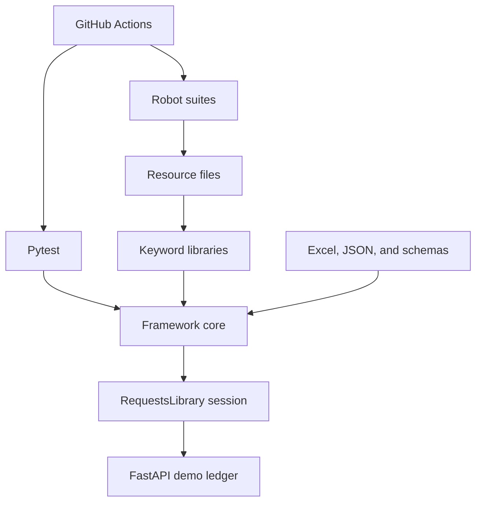

# Enterprise API Automation Framework

Reusable REST API automation framework for senior QA automation work. Robot Framework suites express the scenarios. A Python core owns HTTP calls, tokens, validation, test data, retries, and log masking. A local FastAPI ledger is the system under test, so a run does not depend on a third-party API.

Balances, users, and tokens in this repository are synthetic. Nothing here talks to a real bank or payment network.

## Architecture



The source diagram is `docs/architecture.mmd`.

Dependency direction:

- Suites call resource files.
- Resource files call Robot keyword libraries.
- Keyword libraries call the Python core.
- The core does not import FastAPI.
- The demo API does not import the framework.
- Pytest tests the core directly and drives the demo API over HTTP.

HTTP goes through one client. That client uses Robot Framework RequestsLibrary for the session and applies this project's retry policy on top. RequestsLibrary's own connection retries are turned off (`max_retries=0`), so a POST is not repeated by a hidden adapter.

Retries run for `GET` and `HEAD`, and for calls the caller marks idempotent, when the failure is a connection error or HTTP 429 or 503. A normal POST, including a withdrawal, is not retried.

## Technology stack

| Piece | Role |
| --- | --- |
| Python 3.13 | Framework, demo API, and tests |
| Robot Framework 7.5 | Suites and keywords |
| RequestsLibrary 0.9.7 | HTTP sessions |
| Pabot 4.3 | Parallel suites |
| Requests | Transport used by RequestsLibrary |
| JSON Schema | Contract checks |
| openpyxl | Excel test data |
| Pytest 9 | Unit and integration tests |
| Allure Pytest and Allure Robot Framework | Result files |
| FastAPI and Uvicorn | Local demo API |
| PyJWT | Demo bearer tokens |
| GitHub Actions | CI, audit, and report artifacts |
| pip-audit | Dependency vulnerability check |

Versions are pinned in `requirements.txt`.

## Features

- `GET`, `POST`, `PUT`, `PATCH`, and `DELETE` keywords.
- Login once per role, reuse the bearer token, and keep passwords out of Robot arguments.
- `local` and `staging` YAML profiles selected with `TEST_ENV`.
- Shared headers, correlation IDs, and idempotency keys.
- JSON field checks and JSON Schema validation.
- Positive and negative suites.
- Data-driven rows from Excel and JSON.
- Unique emails, idempotency keys, and decimal amounts generated per case.
- Timeouts from the environment file.
- Safe retries.
- Request and response logs with sensitive fields replaced by `***`.
- RequestsLibrary's own log lines pass through the same redaction.
- Parallel execution with pabot.
- Robot HTML reports, JUnit XML, and Allure result directories.
- An in-memory ledger API with auth, users, accounts, transactions, pagination, validation, and idempotency.

## Folder structure

```text
config/environments/     local.yaml and staging.yaml
demo_api/                FastAPI ledger
framework/core/          config, HTTP, auth, retry, schema, data, masking
framework/robot_libs/    keyword libraries
resources/               Robot resource files
schemas/                 JSON Schemas
test_data/json/          JSON cases
test_data/excel/         Excel workbook
tests/unit/              Pytest without a server
tests/integration/       Pytest against a private API process
tests/robot/             Robot suites
scripts/                 workbook builder, secret scan, full run
.github/workflows/ci.yml GitHub Actions
docs/                    architecture, guides, portfolio text, execution evidence
```

## Installation

```bash
python3 -m venv .venv
source .venv/bin/activate
pip install -r requirements.txt
```

Details and Windows notes are in `docs/installation.md`.

## Configuration

`TEST_ENV` selects `config/environments/<name>.yaml`. The default is `local` (`http://127.0.0.1:8000`, 10 second timeout, 3 attempts). `staging.yaml` is a second profile with a different base URL and timeout so the loader is covered. It is not a live host. The suite runner always starts the local API.

Demo users in the YAML files match the API seed:

| Role | Email | Password |
| --- | --- | --- |
| Admin | `admin@demo.local` | `AdminPass123!` |
| Customer | `customer@demo.local` | `CustomerPass123!` |

Users created during a run use `ValidPass123!` inside Python. Suites do not receive that password as a keyword argument. These values are fixtures. The JWT signing key in `demo_api/security.py` is a fixed demo string, not a production secret.

Set `DEMO_ALLOW_RESET=false` to hide `POST /test/reset`.

## Execution

From the repository root, with the virtual environment active:

```bash
python scripts/run_suite.py
```

That command scans for high-risk secrets, runs Pytest, starts the demo API, runs Robot Framework, runs the same suites under pabot with two processes, and writes `docs/sample-reports/EXECUTION-RESULTS.md` from the XML output.

Run a layer on its own:

```bash
pytest
python -m demo_api --port 8000
robot -d reports/robot tests/robot
PYTHONPATH=. pabot --processes 2 --no-pabotlib -d reports/robot-pabot tests/robot
```

`PYTHONPATH` must include the repository root. `scripts/run_suite.py` sets it. Put the virtualenv's `bin` directory first on `PATH` so pabot does not pick up another Python. The runner does that when `.venv` exists.

More commands, report paths, and the Allure CLI step are in `docs/execution.md`.

## Test scenarios

| Scenario | Where it runs |
| --- | --- |
| Successful GET, POST, PUT, PATCH, DELETE | `tests/robot/api_positive.robot` |
| Login, then an authorized read | `tests/robot/api_positive.robot` and integration auth tests |
| Invalid credentials, missing token, invalid token | `tests/robot/api_negative.robot` |
| Customer blocked from admin and from another account | `tests/robot/api_negative.robot` |
| Missing field, wrong JSON type, duplicate email | `tests/robot/api_negative.robot` |
| Unknown id | `tests/robot/api_negative.robot` |
| Page 0 and page size 101 | `tests/robot/api_negative.robot` |
| Unsupported HTTP method (`POST /health` returns 405) | `tests/robot/api_negative.robot` |
| Schema mismatch | unit test and `Schema Mismatch Is Rejected` |
| Pagination and an empty page | `tests/robot/api_positive.robot` |
| Excel and JSON data-driven cases | `tests/robot/api_data_driven.robot` |
| Boundary amounts: zero, negative, over balance, above 1,000,000.00 | Excel sheet `boundaries` and integration tests |
| Transfer, idempotent replay, key conflict, duplicate debit | `tests/robot/api_transactions.robot` |
| Generated amount and idempotency key | `Generated Amount Deposit` |
| Reset endpoint disabled | `test_reset_disabled` |

Financial cases use decimal strings and an in-memory balance. A repeated transfer with the same `Idempotency-Key` and body returns the original transaction and does not move money twice. The same key with a different body returns 409. Two withdrawals without a key both post.

## Reporting

| Report | Path |
| --- | --- |
| Pytest JUnit | `reports/pytest/junit.xml` |
| Robot HTML | `reports/robot/report.html` and `reports/robot/log.html` |
| Pabot HTML | `reports/robot-pabot/report.html` |
| Allure results | `reports/allure-results` and `reports/allure-results-pabot` |
| Summary written from those XML files | `docs/sample-reports/EXECUTION-RESULTS.md` |

The Allure command-line tool is not required to produce result files. Install the Allure CLI when you want the HTML dashboard:

```bash
allure generate reports/allure-results -o reports/allure-report --clean
allure open reports/allure-report
```

`reports/` is gitignored. The summary file is the committed evidence of a real run.

## CI/CD

`.github/workflows/ci.yml` runs on push and pull request:

1. Install `requirements.txt` on Python 3.13.
2. `pip-audit -r requirements.txt`.
3. `python scripts/run_suite.py`, which includes the secret scan, Pytest, the demo API, Robot, and pabot.
4. Upload Pytest, Robot, pabot, and Allure directories as the `execution-reports` artifact even when the job fails.

The workflow YAML parses. The commands in the workflow are the commands that passed locally. This checkout has not yet been executed by GitHub-hosted runners until the first push.

## Example execution results

Produced by `python scripts/run_suite.py` on 2026-11-24 16:22:44 UTC:

| Layer | Passed | Failed |
| --- | ---: | ---: |
| Pytest unit and integration | 23 | 0 |
| Robot Framework | 18 | 0 |
| Pabot, 2 processes | 18 | 0 |

`pip-audit` reported no known vulnerabilities in `requirements.txt` after Pytest was pinned to 9.0.3. The secret scan reported no high-risk credentials. Robot `output.xml` from that run does not contain the demo passwords or a JWT.

## Business value

Teams get one automation stack they can point at a new REST service without copying HTTP and auth code into every suite. The demo ledger shows the same patterns used on account and payment APIs: authorization, pagination, validation errors, idempotent posts, and parallel runs that do not share balances. A client can replace the base URL and schemas and keep the keywords.

Use cases:

- Regression suite for an internal REST platform.
- Contract checks against JSON Schemas in CI.
- Safe retry and masking standards for logs and Robot reports.
- Data-driven negative testing from Excel sheets maintained by QA.

Portfolio write-up, Upwork text, and service offerings are in `docs/portfolio/`.

## Known limitations

- The ledger state lives in memory in one API process. Restarting the process restores the seed.
- `staging.yaml` is configuration only.
- Idempotency is recorded after a successful post. A failed post does not consume the key.
- An admin cannot post a transaction on an account they do not own.
- Allure HTML is generated only when the Allure CLI is installed. This machine did not have it. Robot HTML and the Allure result files are still produced.
- Parallel suites must create their own users. They must not share one balance.
- Demo fixture passwords are committed on purpose and are not production credentials.
